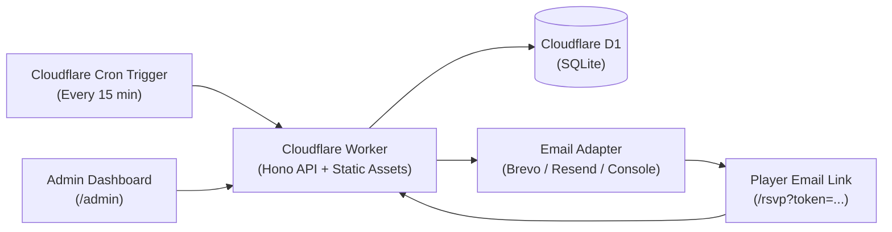
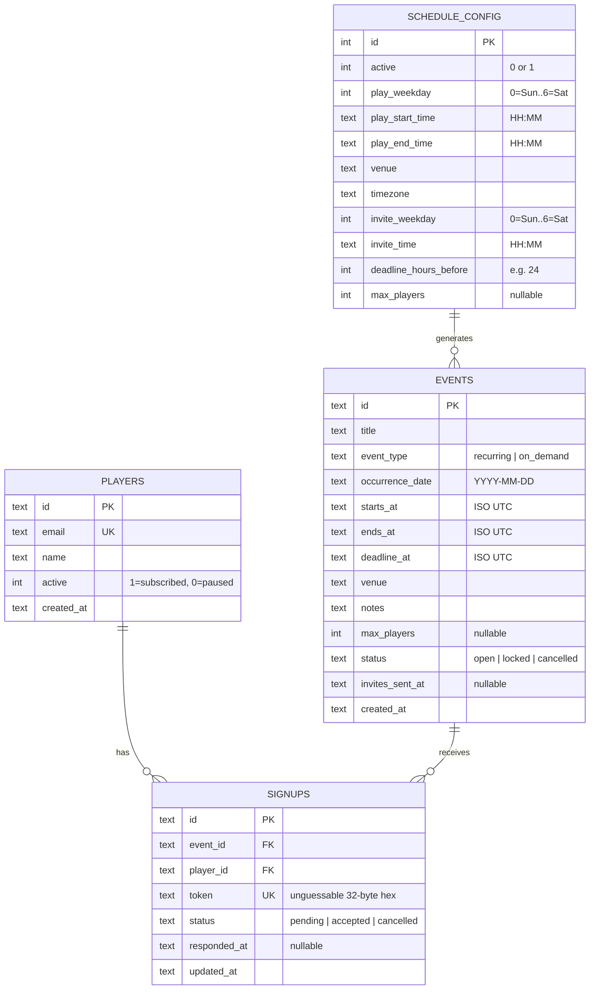

# Implementation Plan: Weekly Badminton Signup Web App

## Goal Description
Build a lightweight, zero-cost web application to manage a roster of player emails and automate weekly (plus on-demand) badminton play signups:
- **Recurring & on-demand scheduling**: Configure the default weekly play day, start/end hours, venue/court notes, invite send schedule, and hard signup/cancellation deadline—plus create one-off/on-demand sessions anytime.
- **Zero-login email RSVP**: Weekly and on-demand emails contain unique per-player signed links so players can **Accept** or **Cancel** an earlier signup in one click up until the hard deadline.
- **Password-protected dashboard**: View who is signed up, cancelled, or pending for any weekly or on-demand occasion; manage the email roster, schedules, deadlines, and manual invites.
- **Print-friendly final roster**: Clean `@media print` / dedicated print view of the final confirmed player list with check-in boxes.
- **100% Free Stack**: Designed around **Cloudflare Workers + D1 (SQLite) + Cron Triggers** and **Brevo or Resend** free tiers (no credit card required, no cold-sleep downtime).

---

## User Review Required

> [!IMPORTANT]
> **Free Stack Selection (Cloudflare Workers + D1 + Cron Triggers)**
> - **Why Cloudflare over Vercel Hobby**: Vercel Hobby restricts Vercel Cron to **once per day**, whereas Cloudflare Workers Free gives **up to 5 Cron Triggers down to 1-minute resolution**, **100,000 requests/day**, **D1 SQLite (5M reads/day, 100K writes/day, 5GB storage)**, and no sleeping server.
> - **Framework Choice**: **Hono (API + SSR/email templates) + React/Vite SPA (served via Workers Static Assets)** in a single Cloudflare Worker keeps request CPU time well under the Workers Free **10ms CPU limit** (unlike heavier SSR frameworks).
> - **Email Provider (HTTP API)**:
>   - **Brevo (Free: 300 emails/day)** works **without a custom domain** (using a verified sender email, with a small Brevo footer on free plan).
>   - **Resend (Free: 3,000/month, 100/day)** has zero footer branding, **requires a verified custom domain**.
>   - Gmail SMTP is intentionally avoided because Workers cannot open raw SMTP sockets and cloud IPs frequently trigger Gmail anti-abuse blocks.

> [!WARNING]
> **Email Link Security Scanner Protection**
> Email clients (Outlook SafeLinks, Gmail scanners, corporate proxies) pre-fetch `GET` URLs inside emails. Therefore, clicking an email link will **never** mutate the database on `GET`; it opens a clean confirmation page where the player confirms or toggles `Accept` / `Cancel` via `POST` (with deadline enforcement on the server).

---

## Open Questions

> [!NOTE]
> Please confirm or adjust these details before execution (reasonable defaults are noted):
> 1. **Email provider**: Do you own a custom domain for **Resend**, or should we default to **Brevo** (verified personal email sender, 300/day free) + keep Resend as a drop-in adapter? *(Default: support both via `EMAIL_PROVIDER=brevo|resend|console`)*
> 2. **Timezone & default schedule**: What local timezone should recurring events & deadlines use (e.g., `Europe/Helsinki`, `Asia/Ho_Chi_Minh`, `UTC`)?
> 3. **Max player capacity / waitlist**: Should events optionally have a player cap (e.g., max 8 or 12 players) with automatic waitlist promotion on cancellation, or unlimited signups? *(Default: optional `max_players` field, unlimited when empty)*
> 4. **Optional reminder email**: Besides the weekly invite email, do you want an optional automatic reminder (e.g., 6 hours before the hard deadline) to players who haven't responded yet?

---

## Architecture Overview

### Data Model (Cloudflare D1 / SQLite)

---

## Proposed Changes

### Project Scaffolding & Tooling (`matin-weekly/`)
Initialize a clean TypeScript full-stack Cloudflare Worker project using pnpm/npm workspaces or a single Vite + Hono Worker setup.

#### [NEW] package.json
- Dependencies: `hono`, `zod`, `react`, `react-dom`, `lucide-react`
- DevDependencies: `wrangler`, `vite`, `@cloudflare/vite-plugin` (or Vite build to `dist/client` + `wrangler deploy`), `typescript`, `vitest`, `@types/react`, `@types/react-dom`
- Scripts: `dev`, `build`, `test`, `db:migrate:local`, `db:migrate:remote`, `deploy`

#### [NEW] wrangler.jsonc
- Configure Worker entry (`src/worker/index.ts`), Static Assets (`dist/client` with `run_worker_first: ["/api/*", "/rsvp*"]`), D1 binding (`DB`), and Cron Trigger (`"*/15 * * * *"`).
- Non-secret vars (`APP_BASE_URL`, `EMAIL_PROVIDER`, `EMAIL_FROM`, `DEFAULT_TIMEZONE`) + secrets via `wrangler secret put` (`ADMIN_PASSWORD`, `SESSION_SECRET`, `BREVO_API_KEY` / `RESEND_API_KEY`).

---

### Database & Migrations (`migrations/`, `src/worker/db/`)
#### [NEW] migrations/0001_init.sql
- Create `schedule_config`, `players`, `events`, `signups`, and `invite_logs` tables plus unique index on `signups(event_id, player_id)` and `signups(token)`.
- Seed default `schedule_config` row (e.g., disabled until configured in `/admin`).

#### [NEW] src/worker/db/queries.ts
- Typed D1 query helpers:
  - Roster CRUD (`listPlayers`, `upsertPlayers`, `togglePlayerActive`, `deletePlayer`)
  - Schedule CRUD (`getScheduleConfig`, `updateScheduleConfig`)
  - Events CRUD (`listEvents`, `getEventWithSignups`, `createEvent`, `updateEvent`, `cancelEvent`)
  - RSVP operations (`getSignupByToken`, `updateSignupStatus` with atomic deadline check `datetime('now') <= deadline_at`)

---

### Scheduling, Cron & Email Delivery (`src/worker/services/`)
#### [NEW] src/worker/services/scheduler.ts
- Pure, unit-testable date/timezone calculation helpers (using `Intl.DateTimeFormat`—zero heavy timezone library bloat):
  - Compute next recurring occurrence (`starts_at`, `ends_at`, `deadline_at`) in configured timezone.
  - Idempotent `runScheduledTick(db, env, now)`:
    1. If `schedule_config.active === 1` and current local weekday/time is at or past `invite_weekday` + `invite_time` for this week's occurrence, create the `recurring` event if not already created (`UNIQUE(event_type, occurrence_date)` or lookup) and dispatch invites.
    2. Lock events whose `deadline_at <= now` (`status = 'locked'`).
- On-demand events can be created immediately with custom date, start/end hour, hard deadline, venue, and optional "Send invites immediately" flag.

#### [NEW] src/worker/services/email.ts
- Provider interface `EmailProvider`:
  - `BrevoProvider`: `POST https://api.brevo.com/v3/smtp/email`
  - `ResendProvider`: `POST https://api.resend.com/v3/emails`
  - `ConsoleProvider`: logs rendered HTML + RSVP links locally for zero-config dev testing
- Renders responsive HTML + plain-text invite emails containing:
  - Event date, hours, venue, notes, and **hard deadline** (formatted in event timezone).
  - Direct **Accept / Manage Signup** and **Cancel Signup** links (`/rsvp?token=...&intent=accept` and `/rsvp?token=...&intent=cancel`).

---

### Backend API & Auth (`src/worker/routes/`)
#### [NEW] src/worker/middleware/auth.ts
- Stateless HMAC-SHA256 signed HTTP-only cookie (`badminton_admin`) using Web Crypto API (`crypto.subtle`) verified against `ADMIN_PASSWORD` + `SESSION_SECRET` with constant-time comparison and 7-day expiry.

#### [NEW] src/worker/routes/rsvp.ts
- `GET /api/rsvp/:token`: Returns event summary, player name/email (masked or display name), current RSVP status (`pending` | `accepted` | `cancelled`), deadline timestamp, and `isPastDeadline` boolean.
- `POST /api/rsvp/:token`: Body `{ status: "accepted" | "cancelled" }`. Rejects with `409 Conflict` if `now > deadline_at` or event is `cancelled`/`locked`; otherwise updates `signups` and returns updated state.

#### [NEW] src/worker/routes/admin.ts
Protected by `requireAdmin` middleware:
- `POST /api/auth/login` & `POST /api/auth/logout` & `GET /api/auth/me`
- `GET/PUT /api/admin/schedule` — view/update recurring day, hours, invite send time, deadline rule, venue
- `GET/POST /api/admin/players` — list, add single or bulk paste emails, toggle active/paused, delete
- `GET/POST/PATCH /api/admin/events` — list events, create on-demand event, edit event date/hours/deadline, cancel event, trigger invite send (`POST /api/admin/events/:id/send-invites`), or manually set a player's RSVP status

---

### Frontend Pages & Print View (`src/client/`)
#### [NEW] src/client/pages/RsvpPage.tsx
- Public player page at `/rsvp?token=...`:
  - Shows event title, date, hours, venue, countdown/hard deadline.
  - Shows current status badge (`Pending` / `Signed Up` / `Cancelled`).
  - Large **Accept / Confirm Signup** and **Cancel Signup** buttons (respecting optional `?intent=accept|cancel` highlight while still requiring an intentional click so email scanners never auto-toggle).
  - Locked banner after hard deadline.

#### [NEW] src/client/pages/AdminLoginPage.tsx & AdminDashboardPage.tsx
- Clean password login form at `/admin/login`.
- Dashboard at `/admin`:
  - **Events & Attendance tab**: Event selector (next recurring + on-demand + history), live counts (`Accepted` / `Cancelled` / `Pending`), player table with response timestamps, manual override toggle, "Send Invites / Resend to Pending", and **"Print Final List"** button.
  - **Create On-Demand Event modal**: Pick any date, start/end hour, hard deadline date/time, venue, notes, and send immediately or save draft.
  - **Recurring Schedule tab**: Day of week, start/end hour, venue, invite send day/time, hard deadline (`X` hours before play), enable/pause recurring invites.
  - **Email Roster tab**: Add single or paste comma/newline-separated emails, pause/resume, remove.

#### [NEW] src/client/pages/PrintRosterPage.tsx
- Dedicated route `/admin/events/:id/print` + `@media print` stylesheet:
  - High-contrast black-and-white layout, no nav chrome, fits cleanly on A4/Letter.
  - Displays event title, date & time window, venue, hard deadline, total confirmed count, numbered table (`#`, `Player Name`, `Email`, `Signed Up At`, `Court Check-in [ ]`), and optional standby/cancelled summary at the bottom.

---

## Verification Plan

### Automated Tests
Run with Vitest (`pnpm test`):
1. **Scheduler & Deadline Logic** (`tests/scheduler.test.ts`):
   - Recurring occurrence calculation across DST boundaries and weekdays.
   - Deadline cutoff enforcement (`now <= deadline_at` allowed, `now > deadline_at` rejected with `409`).
   - Idempotency: running cron tick multiple times in the same window never creates duplicate weekly events or double-sends invites.
2. **RSVP & Admin API Integration** (`tests/api.test.ts`):
   - Token lookup, `pending -> accepted -> cancelled -> accepted` transitions before deadline, rejection after deadline.
   - Auth cookie signing/verification, unauthorized rejection (`401`) on `/api/admin/*`.
   - Bulk email roster validation and duplicate handling.

### Manual & Local Verification
1. Run `pnpm db:migrate:local` and `pnpm dev` (Wrangler local D1 + Console email provider).
2. Trigger local cron endpoint (`curl "http://localhost:8787/__scheduled?cron=*/15+*+*+*+*"` or admin "Send Invites" button) and verify console output prints personalized Accept/Cancel links.
3. Open RSVP links in browser: confirm `GET` does not mutate state, test `Accept`, `Cancel`, and past-deadline lock behavior.
4. Log into `/admin` with password, verify live counts, create an on-demand session, and verify `/admin/events/:id/print` via browser Print Preview (`Cmd+P` / PDF export).
5. Deploy free stack (`pnpm deploy` + `wrangler d1 migrations apply ... --remote` + `wrangler secret put ...`) and verify production smoke test.
